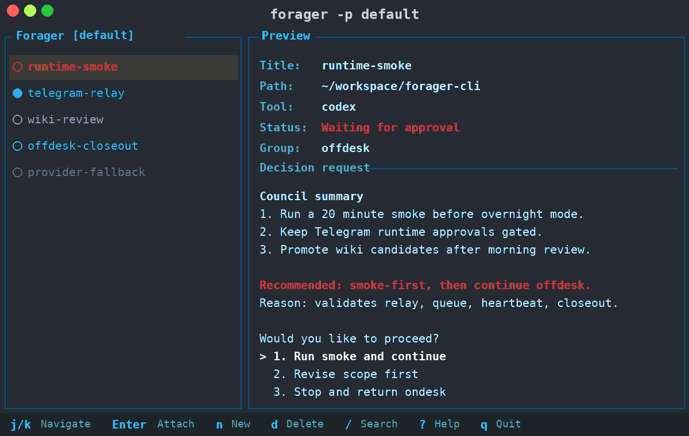

<div align="center">
  
  <h1 align="center">Forager</h1>
  <p align="center">
    <a href="https://kimyoungjin06.github.io/forager-cli/"></a>
    <a href="https://github.com/kimyoungjin06/forager-cli/actions/workflows/ci.yml"></a>
    <a href="LICENSE"></a>
    <a href="https://github.com/kimyoungjin06/forager-cli/releases"></a>
  </p>
</div>

Run coding agents locally. Return to their sessions, results, and next steps.
Forager is a local meta-harness built on tmux and written in Rust.

> Forager lets people entrust meaningful work to agents and return to evidence,
> choices, and continuity instead of mystery.

Start with Claude Code, Codex, OpenCode, Gemini CLI, or Mistral Vibe in separate
tmux sessions and optional Git worktrees. Keep a paired terminal for each agent,
inspect its status and diff, and reconnect from the TUI.

For longer work, prepare a bounded Offdesk task and return to its evidence and
review. Record the agreed next step before continuing. Telegram provides remote
inspection and confirmation-based controls; the adaptive wiki keeps lessons as
candidates until they are reviewed. `forager` is the primary command and `aoe`
is its compatibility alias.

[Install](docs/installation.md) · [Quick start](docs/quick-start.md) ·
[Daily workflow](docs/guides/operation-cycle.md) ·
[Website and workspace preview](https://kimyoungjin06.github.io/forager-cli/)



## Installation

Linux or macOS, [tmux](https://github.com/tmux/tmux/wiki), and an installed agent
CLI. Building from source also requires Rust 1.88 or later.

```bash
# Quick install (Linux & macOS)
curl -fsSL \
  https://raw.githubusercontent.com/kimyoungjin06/forager-cli/main/scripts/install.sh \
  | bash

# Build from source
git clone https://github.com/kimyoungjin06/forager-cli
cd forager-cli
cargo build --locked --release
./target/release/forager
```

The installer downloads a tagged release. This source tree may contain newer
work; check the [release notes](docs/releases/v0.14.0.md) and
[operation status](docs/offdesk-operation-status.md) for the applicable scope.

## Quick Start

```bash
# Launch the TUI
forager

# Add a session from CLI
forager add /path/to/project

# Add a session on a new git branch
forager add . -w feat/my-feature -b

```

In the TUI: `n` to create a session, `Enter` to attach, `t` to toggle terminal view, `D` for diff view, `d` to delete, `?` for help.

Use **`Ctrl+b d`** to detach from an agent and return to Forager. Closing the
TUI leaves agent tmux sessions running on the same host.

## From a session to bounded work

| Step | What you do |
| --- | --- |
| Prepare | Select a project TODO, scope, executor, evidence and stop conditions. |
| Run | Approve the selected execution and preserve its runtime evidence. |
| Review | Inspect results, checks, failures and unresolved questions. |
| Agree | Record the accepted, reworked or deferred outcome in the owning TODO. |
| Resume | Continue the next concrete step from a saved handoff. |

Forager keeps execution status, result review and listener health distinct.
Completed work can still need review. See the
[operation cycle](docs/guides/operation-cycle.md) before configuring Offdesk,
and the [Telegram guide](docs/remote-operator.md) for remote supervision.

Local command workloads need an explicitly configured executor. Local-model
coding and recovery qualification remains task-specific; support for running
a command does not certify every model or autonomous workflow. The
[operation status](docs/offdesk-operation-status.md) records these boundaries.

## Documentation

- [Installation and upgrades](docs/installation.md)
- [Session and worktree workflow](docs/guides/workflow.md)
- [Configuration](docs/guides/configuration.md) and [repo hooks](docs/guides/repo-config.md)
- [CLI reference](docs/cli/reference.md)
- [Remote operator](docs/remote-operator.md)
- [Current operation status](docs/offdesk-operation-status.md)
- [Product direction](docs/project-direction.md) and [harness contracts](docs/hosted-harness-agents.md)

## FAQ

### What happens when I close Forager?

The agent processes continue in tmux while the host stays running. Reopen
`forager` to attach again. A host reboot stops those processes; persistent task
records and supported harness checkpoints are separate from a live session.

### Which harness-backed agents are supported?

Claude Code, OpenCode, Mistral Vibe, Codex CLI, and Gemini CLI. Forager
auto-detects which are installed on your system.

## Troubleshooting

### Using Forager with mobile SSH clients (Termius, Blink, etc.)

Run `forager` inside a tmux session when connecting from mobile:

```bash
tmux new-session -s main
forager
```

Use `Ctrl+b L` to toggle back to Forager after attaching to an agent session.

### Claude Code is flickering

This is a known Claude Code issue, not a Forager problem: https://github.com/anthropics/claude-code/issues/1913

## Development

```bash
cargo check          # Type-check
cargo test           # Run tests
cargo fmt            # Format
cargo clippy         # Lint
cargo build --release  # Release build

# Debug logging
FORAGER_DEBUG=1 cargo run --bin forager
```

## Acknowledgments

Inspired by [agent-deck](https://github.com/asheshgoplani/agent-deck) (Go + Bubble Tea).

## License

MIT License -- see [LICENSE](LICENSE) for details.
