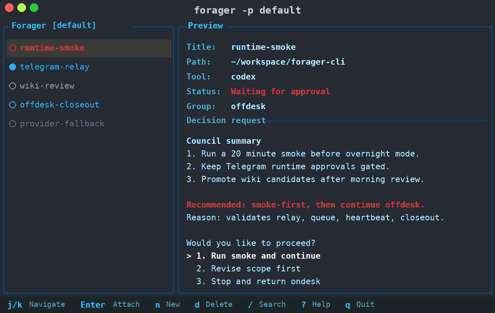

# Forager

A local meta-harness for harness-backed AI coding agents on Linux and macOS,
built on tmux and written in Rust.

> Forager lets people entrust meaningful work to agents and return to evidence,
> choices, and continuity instead of mystery.

Start with a coding agent in a tmux session and an optional Git worktree. Keep
its terminal and diff close at hand, then prepare bounded Offdesk work when you
are ready. Forager preserves the task's evidence and review so you can return
to an agreed next step.

## Choose a starting point

| Your goal | Start here |
| --- | --- |
| Install and open your first session | [Installation](installation.md), then [Quick start](quick-start.md) |
| Work on separate branches | [Session workflow](guides/workflow.md) and [Git worktrees](guides/worktrees.md) |
| Prepare work and review it on return | [Operation cycle](guides/operation-cycle.md) |
| Inspect and control work from Telegram | [Remote operator](remote-operator.md) |
| Understand the supported scope | [Operation status](offdesk-operation-status.md) |
| Look up a command or setting | [CLI reference](cli/reference.md) and [Configuration](guides/configuration.md) |

The public website's workspace pages are static previews. Local exports and
an explicitly configured local action bridge supply your own workstation data
and controls. See the [remote operator guide](remote-operator.md) for setup.

Release downloads contain tagged versions. This documentation tree may describe
newer source changes; use the [release notes](releases/v0.14.0.md) for the
published version and [operation status](offdesk-operation-status.md) for scope.

## Why Forager?

AI coding agents are strong enough to do meaningful work, but long-running work
often becomes hard to inspect after the fact. Forager keeps the useful autonomy
and makes the operating boundary explicit:

- **Entrust** a bounded task to a chosen harness-backed agent.
- **Observe** what actually ran through local state, tmux, heartbeat, progress,
  logs, and result artifacts.
- **Return** to evidence, risks, next choices, and handoff packages.
- **Promote** only reviewed lessons into durable project knowledge.

## Supported Harness-Backed Agents

Claude Code, OpenCode, Mistral Vibe, Codex CLI, and Gemini CLI are auto-detected
for interactive sessions. Other command workloads need explicit configuration
and checks for their selected task. Local-model coding and context recovery
remain task-specific qualification work; running a command alone does not
establish those outcomes.

## Core Surfaces

- **TUI dashboard**: create, monitor, attach, recover, and review sessions.
- **Paired terminals**: run git, builds, tests, and inspection commands without
  interrupting the agent.
- **Offdesk runtime**: queue bounded work, require approval, preserve runtime
  evidence, and close out before returning Ondesk.
- **Adaptive wiki**: capture agent-created lessons as candidates and promote
  only reviewed knowledge.
- **CLI/JSON**: keep automation and audit grounded in durable local state.

## Product and implementation references

[Project direction](project-direction.md) describes the product's goals.
[Harness contracts](hosted-harness-agents.md),
[functional definitions](functional-definitions.md),
[decision pipeline](decision-pipeline.md) and
[evidence and memory boundaries](evidence-search-and-memory-boundary.md)
explain the design. Benchmarking and implementation proposals are grouped under
Design and development in the navigation.

<strong>Ready to get started?</strong>

<a href="installation.html">Install Forager</a>

